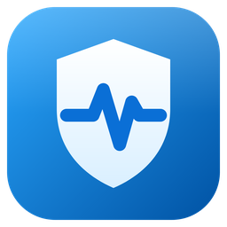

# PC Sentinel

<p align="center">
  
</p>

<p align="center">
  <a href="https://github.com/ThurCintra/pc_tensor/actions/workflows/ci.yml"></a>
  <a href="https://github.com/ThurCintra/pc_tensor/releases/latest"></a>
  <a href="LICENSE"></a>
</p>

Monitor de hardware para Windows: temperaturas, uso de CPU, memória, discos e rede em tempo real, com
alertas quando o PC esquenta e acesso pelo celular na mesma rede Wi-Fi.

Feito com Electron + React. O visual segue o Windows 11 e acompanha o tema claro ou escuro do sistema.

## Funcionalidades

- **Visão geral:** temperatura e uso de CPU e GPU, memória, latência de rede, uso por núcleo, ocupação e
  velocidade dos discos, outros sensores (placa-mãe, SSD, ventoinha) e diagnóstico de gargalo.
- **Histórico:** gráficos de temperatura e uso dos últimos 2, 5 ou 15 minutos, com mínimo, média e máximo,
  e o resumo da última sessão de carga (jogo, renderização).
- **Processos:** os programas que mais consomem, com opção de encerrar (processos do Windows são protegidos).
- **Controles:** mídia (tocar/pausar, faixas, volume), plano de energia e Modo Boost, que fecha apps em
  segundo plano para liberar memória.
- **Hardware:** sistema, placa-mãe, processador, placa de vídeo, memória, discos e rede; copiar resumo ou
  exportar em JSON.
- **Alertas de temperatura:** notificação do Windows, aviso no app e vibração no celular quando CPU ou GPU
  passam do limite configurado.
- **Celular:** o mesmo app abre no navegador do celular pelo QR Code, sem instalar nada (pode ser adicionado
  à tela inicial).
- **Modo compacto:** barra pequena sempre visível com CPU, GPU e RAM.

Sem sensor disponível, o app mostra "Sem sensor" em vez de estimar valores.

## Instalação (uso normal)

1. Baixe o `PC-Sentinel-Setup.exe` da [última release](https://github.com/ThurCintra/pc_tensor/releases/latest)
   ou gere o instalador (veja abaixo).
2. Rode o instalador. Ele cria os atalhos e libera a porta do celular no firewall.
3. Abra o **PC Sentinel** pelo menu Iniciar. O Windows pede permissão de administrador ao abrir: ela é
   necessária para ler as temperaturas.

Fechar a janela mantém o app na bandeja do sistema; para sair, use **Sair** no ícone da bandeja.

## Desenvolvimento

Pré-requisitos: Windows 10/11 x64 e Node.js 20 ou superior.

```bash
npm install
```

```bash
npm run dev
```

Abre o app com recarga automática ao editar a interface. Para ler temperaturas durante o desenvolvimento,
rode o terminal como administrador.

| Comando | O que faz |
|---|---|
| `npm run dev` | App em modo de desenvolvimento (Vite + Electron) |
| `npm start` | Compila a interface e abre o app (no app, **Configurações → Reiniciar como administrador** libera os sensores) |
| `npm test` | Testes unitários (Vitest) |
| `npm run lint` | Análise estática (ESLint) |
| `npm run format` | Formata o código (Prettier) |
| `npm run check` | Lint, formatação e testes (o mesmo que o CI roda) |
| `npm run build` | Compila a interface em `dist/` |
| `npm run build:bridge` | Recompila a ponte de sensores C# (`resources/sensor-bridge/pc-sensor-bridge.exe`) |
| `npm run dist` | Gera o instalador em `release/PC-Sentinel-Setup.exe` |

### Publicar uma release

```bash
npm version patch
git push --follow-tags
```

`npm version` (ou `minor`/`major`) atualiza a versão e cria a tag `vX.Y.Z`. Ao receber a tag, o GitHub Actions
roda os testes, gera o instalador e publica a release com o `PC-Sentinel-Setup.exe` anexado.

## Celular

No PC, abra **Celular** e leia o QR Code com a câmera. O link leva um código de pareamento que permite ver a
telemetria e usar os controles, então compartilhe só com aparelhos seus. Para desconectar todos os
aparelhos, use **Desconectar todos os aparelhos** na mesma tela.

Se o celular não abrir a página, confira se os dois estão na mesma rede e se a porta (padrão 3890) está
liberada no firewall. O instalador e o app rodando como administrador criam a regra
`PC Sentinel LAN (3890)` sozinhos.

## Configurações

Ficam em `%APPDATA%\pc-sentinel\settings.json` e podem ser alteradas na tela **Configurações**:

- limites de temperatura de CPU e GPU (50 a 105 °C) e intervalo mínimo entre avisos;
- iniciar com o Windows (no app instalado);
- porta do servidor do celular;
- lista de apps fechados pelo Modo Boost.

O histórico térmico de longo prazo fica em `%APPDATA%\pc-sentinel\thermal_history.json`.

## Estrutura

```
src/
├── main/                     Processo principal do Electron
│   ├── index.js              Inicialização, loop de métricas e encerramento
│   ├── windows.js            Janela principal, QR Code e modo compacto
│   ├── tray.js               Ícone e menu da bandeja
│   ├── ipc.js                Canais IPC usados pela interface
│   ├── system.js             Administrador, iniciar com o Windows, notificações
│   ├── settings-store.js     Preferências e código de pareamento
│   └── telemetry/            Coletor, ponte de sensores, rede, processos, histórico e alertas
├── preload/index.js          Ponte segura entre a interface e o processo principal
├── renderer/                 Interface React (mesma para desktop e celular)
└── server/                   Servidor do celular (API, WebSocket, ações remotas)
native/sensor-bridge/         Código C# da ponte de sensores
resources/sensor-bridge/      Ponte compilada e DLLs do LibreHardwareMonitor
scripts/                      Scripts de build
tests/                        Testes, na mesma estrutura de src/
docs/                         Arquitetura e modelo de segurança
```

Detalhes de arquitetura e do modelo de segurança em [docs/arquitetura.md](docs/arquitetura.md).

## Contribuindo

Veja o [guia de contribuição](CONTRIBUTING.md). Falhas de segurança devem ser relatadas em privado, conforme a
[política de segurança](SECURITY.md).

## Licença

[MIT](LICENSE). A ponte de sensores usa o [LibreHardwareMonitor](https://github.com/LibreHardwareMonitor/LibreHardwareMonitor)
(MPL-2.0); veja [os avisos de terceiros](resources/sensor-bridge/THIRD_PARTY_NOTICES.md).
