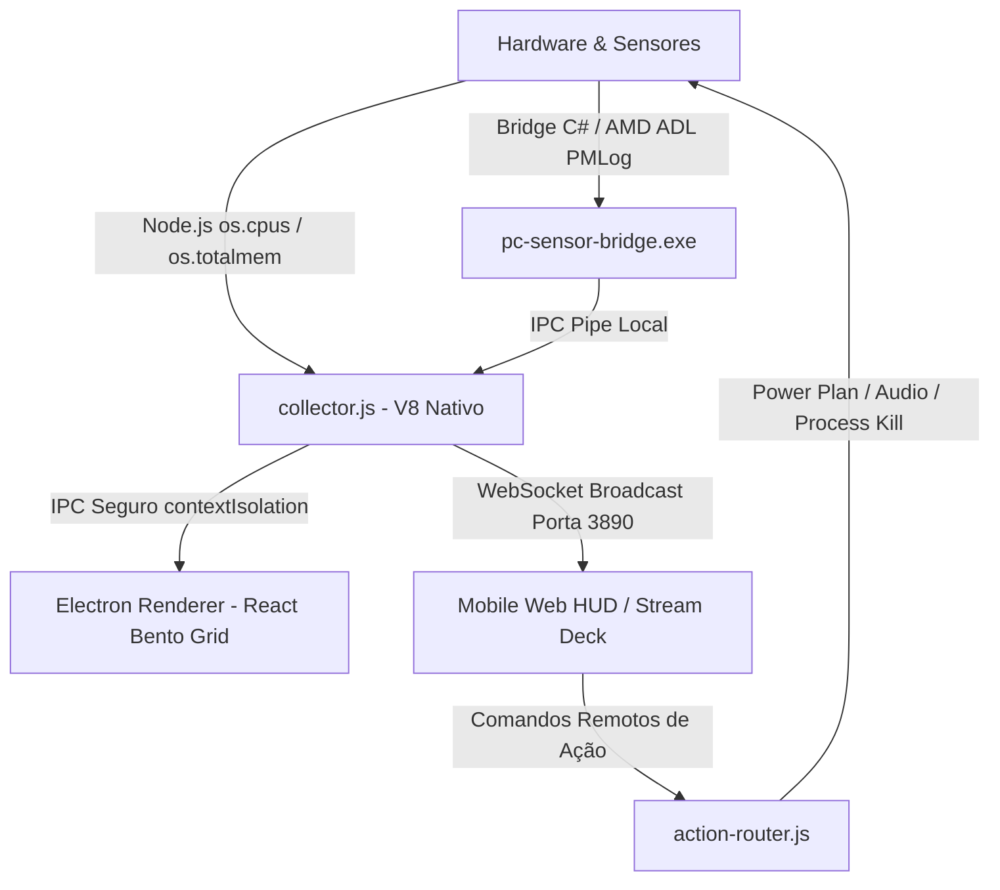

# ⚡ PC SENTINEL — Dark Cyber-Clean Telemetry & Mobile HUD

<p align="center">
  
</p>

<p align="center">
  <strong>Monitoramento em tempo real de hardware, telemetria térmica avançada e streaming ao vivo para dispositivos móveis com controles táteis estilo Stream Deck.</strong>
</p>

<p align="center">
  
  
  
  
  
  
</p>

---

## 📌 Visão Geral

O **PC Sentinel** é uma aplicação desktop nativa desenvolvida em **Electron + React** focada em telemetria técnica de alta performance com a estética **Dark Cyber-Clean**. 

Projetado para entusiastas, gamers, desenvolvedores e profissionais de TI, o PC Sentinel permite acompanhar a saúde, temperaturas e consumo de hardware tanto na máquina local quanto **em tempo real na tela de qualquer smartphone ou tablet** conectado à mesma rede Wi-Fi via interface WebSockets sem fios, eliminando a necessidade de alternar janelas (Alt+Tab) durante jogos ou renderizações pesadas.

---

## ✨ Principais Funcionalidades

### 🖥️ Dashboard Desktop (Bento Grid Modular)
- **Presets de Layout Dinâmicos:**
  - 🎮 **GAMING:** Foco em térmicas de CPU/GPU, diagnóstico dinâmico de gargalo e latência de rede.
  - 💻 **DEV / WORK:** Foco na lista de processos ativos, consumo de swap e equalizador multi-core.
  - 🥷 **STEALTH:** Interface minimalista e de baixo contraste para uso noturno ou monitoramento discreto.
- **Hero Thermal Gauges:** Medidores radiais escaláveis com leitura de sensores reais (via AMD ADL PMLog e LibreHardwareMonitorLib) ou modelo termodinâmico contínuo.
- **Spline Chart Interativo:** Gráfico de tendências térmicas e carga com filtros de janela temporal (5 min, 15 min, 30 min) e estatísticas instantâneas (mínima, média, pico).
- **Equalizador Multi-Core por Núcleo:** Monitoramento segmentado da carga individual de cada núcleo/thread da CPU.
- **Cooling / Cooler Físico:** Animação de rotação com velocidade física proporcional ao RPM real e monitoramento PWM das ventoinhas.
- **Monitor de Armazenamento & Disk I/O:** Taxas de leitura e gravação em tempo real (MB/s) com ocupação de partições (SSD, NVMe, HDD).
- **Diagnóstico Dinâmico de Gargalo:** Detecção automática de estados críticos (*CPU-Bound, GPU-Bound, VRAM Pressure, RAM Swap Risk e Balanced*).
- **Alerta Preventivo de Degradação Térmica:** Algoritmo que compara a resposta térmica atual contra a baseline para alertar sobre acúmulo de poeira nos dissipadores ou pasta térmica ressecada.
- **Relatório de Sessão Térmica (Benchmark Automático):** Janela modal com resumo de pico, engasgos (*thermal throttling*) e exportação em JSON pós-carga.
- **Modo Mini-Widget HUD:** Modo compacto flutuante na tela (Always-on-Top).

---

### 📱 Transmissão Móvel ao Vivo & Stream Deck (Mobile HUD)
- **Pareamento Instantâneo via QR Code:** O app gera automaticamente um QR Code na tela com o IP local da máquina para conexão rápida a partir da câmera do celular.
- **Stream Deck Tátil no Smartphone:**
  - 🚀 **Boost Cleanup:** Libera páginas de memória RAM e encerra processos secundários com um toque.
  - ⚡ **Planos de Energia do Windows:** Alterne entre *Economia de Energia, Equilibrado, Alto Desempenho* e *Desempenho Máximo (Ultimate)* diretamente pelo celular.
  - 🎵 **Controle Remoto de Mídia:** Botões de mute, volume +/- e play/pause.
  - 🛑 **Finalizador Rápido de Processos:** Visualize os Top 5 processos mais pesados e encerre-os remotamente.
  - 📳 **Alertas Hápticos e Visuais:** A tela do smartphone pulsa em vermelho ao detectar temperaturas críticas (>85°C).
- **Zero Instalação no Celular:** Funciona direto no navegador (Safari, Chrome, Firefox, Edge) com suporte a PWA.

---

### 🔍 Hardware & Sistema (Raio-X do PC)
- Identificação precisa de placa-mãe, versão e data da BIOS.
- Especificações do processador (soquete, clocks base/boost, caches L1, L2 e L3).
- Detecção de placas de vídeo primárias e integradas com memória VRAM dedicada e versão de drivers.
- Mapeamento detalhado dos pentes de memória RAM (capacidade, slots, tipo DDR4/DDR5, velocidade MHz e fabricante).
- Status de conectividade com endereço IP, velocidade de link e máscara de privacidade para o endereço MAC.
- Botões de exportação rápida: copiar resumo em Markdown para clipboard ou download completo em JSON.

---

### 📐 Design 100% Responsivo
O PC Sentinel adapta-se dinamicamente a qualquer resolução de tela através de CSS Grid e Flexbox com 4 breakpoints estratégicos:
- **Ultra-Wide & 1080p (`> 1280px`):** Grade de 12 colunas com sidebar de 240px.
- **Laptops / Telas Médias (`1024px - 1280px`):** Agrupamento simétrico de cartões em pares de 6 colunas.
- **Tablets Landscape (`769px - 1024px`):** Sidebar recolhida para um trilho compacto de 68px (ícones com LED de status).
- **Mobile & Janelas Estreitas (`<= 768px`):** Layout em coluna única (`span 12`) com barra de navegação superior horizontal e suporte a smartphones desde 320px de largura.

---

## 🛠️ Arquitetura e Engenharia de Performance



- **Zero-Overhead de Polling:** Substituição de chamadas WMI/PowerShell pesadas por coleta direta via APIs nativas do Node.js (`os.cpus()`, `os.totalmem()`), reduzindo o consumo de CPU da aplicação para ~0.1%.
- **Sensor Bridge Dedicado:** Ponte nativa em C# (`pc-sensor-bridge.exe`) integrada à biblioteca `LibreHardwareMonitorLib` e à API nativa `AMD ADL PMLog` para leitura de temperaturas com precisão de hardware sem engasgos.
- **Conexão Segura:** Preload script com `contextIsolation: true` e `nodeIntegration: false`.

---

## 🚀 Como Executar o Projeto

### Modo 1-Clique (Recomendado)

O projeto conta com o script unificado **`iniciar.bat`**, que realiza todo o ciclo de vida automaticamente:
- **Primeira execução:** Instala todas as dependências (`npm install`), compila a interface (`npm run build`), libera a porta 3890 no Firewall e sincroniza o driver de hardware.
- **Próximas execuções:** Verifica automaticamente se há atualizações no GitHub (`git pull`), valida dependências e inicia o sistema com privilégios de Administrador para leitura direta dos diodos térmicos AMD/Intel.

Basta dar **duplo clique** no arquivo:
```cmd
iniciar.bat
```

---

### Execução Manual via Terminal

#### Pré-requisitos
- **Windows 10 ou 11 (x64)**
- **Node.js 18+** instalado
- **Git** instalado

#### 1. Clonar o Repositório
```bash
git clone https://github.com/ThurCintra/pc_tensor.git
cd pc_tensor
```

#### 2. Instalar as Dependências
```bash
npm install
```

#### 3. Executar em Modo de Desenvolvimento
```bash
npm run dev
```
> O comando acima inicia simultaneamente o servidor Vite com Hot Reload na porta `5173` e a aplicação Electron conectada ao collector de telemetria.

#### 4. Executar os Testes Automatizados
```bash
npm test
```
> Executa a suíte completa de 45 testes unitários via Vitest cobrindo collector, monitor de processos, bridge de sensores, roteador de ações do Stream Deck e servidor mobile.

#### 5. Gerar o Instalador de Produção (.exe)
```bash
npm run dist:installer
```
> O instalador executável padrão Windows (`PC-Sentinel-Setup.exe`) será gerado na pasta `release/`.

---

## 📂 Estrutura de Diretórios

```
pc_tensor/
├── assets/                       # Ícones e identidades visuais do app
├── build/                        # Configurações do instalador NSIS
├── src/
│   ├── main/                     # Processo principal do Electron
│   │   ├── collector.js          # Coletor híbrido de telemetria térmica e hardware
│   │   ├── main.js               # Ciclo de vida da janela e IPC
│   │   └── action-router.js      # Execução de comandos do Stream Deck
│   ├── preload/
│   │   └── preload.js            # Ponte de IPC segura (contextBridge)
│   ├── renderer/                 # Frontend Desktop em React + Vite
│   │   ├── components/
│   │   │   ├── hardware/         # Visão de raio-x e especificações de hardware
│   │   │   ├── telemetry/        # Bento cards (gauges, spline chart, cooling, etc.)
│   │   │   ├── widget/           # Componente do modo Mini-Widget
│   │   │   └── ui/               # BentoCard base com spotlight effect
│   │   ├── App.jsx               # Dashboard principal e gerenciador de abas
│   │   └── index.css             # Design tokens e breakpoints responsivos
│   └── server/                   # Servidor móvel integrado
│       ├── mobile-server.js      # Servidor HTTP / WebSocket local (porta 3890)
│       └── public/
│           └── index.html        # Interface web responsiva para smartphones
├── tests/
│   └── unit/                     # Testes unitários com Vitest (45 testes)
├── tools/
│   └── LibreHardwareMonitor/     # Binários e código-fonte da bridge de sensores C#
├── package.json
└── vite.config.js
```

---

## 📜 Scripts Disponíveis

| Comando | Descrição |
|---|---|
| `npm run dev` | Inicia o ambiente de desenvolvimento completo (Vite + Electron) |
| `npm run build` | Compila os assets do frontend React via Vite |
| `npm test` | Executa todos os testes unitários com Vitest |
| `npm run test:watch` | Executa os testes em modo interativo de monitoramento |
| `npm run start` | Inicia o Electron apontando para o bundle de produção compilado |
| `npm run dist:installer` | Compila o projeto e empacota o instalador NSIS em `release/` |

---

## 🔒 Permissões e Firewall
Para permitir que o smartphone na rede Wi-Fi acesse a porta `3890`:
- Execute o script auxiliar [`liberar-firewall.bat`](file:///c:/Users/Arthur/Desktop/pc_tensor/liberar-firewall.bat) como Administrador, ou crie uma regra de entrada no Firewall do Windows para a porta TCP `3890`.
- Para leitura aprofundada de sensores térmicos de placa-mãe e fans de terceiros, execute o aplicativo através do atalho [`iniciar-admin.bat`](file:///c:/Users/Arthur/Desktop/pc_tensor/iniciar-admin.bat).

---

## 📄 Licença

Distribuído sob a licença **MIT**. Consulte o arquivo de licença para mais detalhes.

---

<p align="center">
  Desenvolvido por <strong>Arthur Cintra</strong> • Feito com foco em performance e precisão.
</p>
